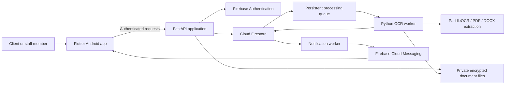
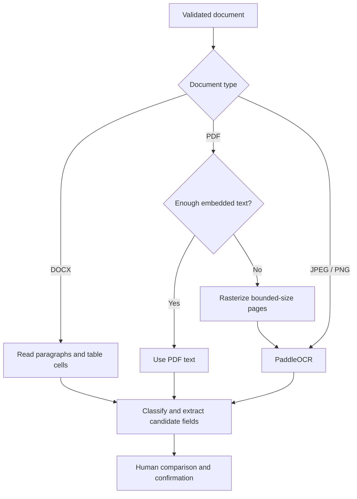
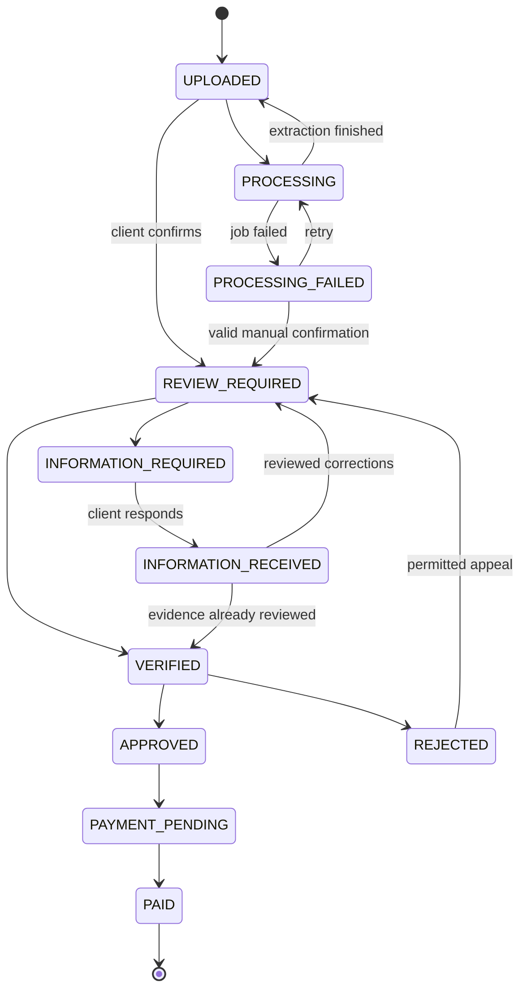
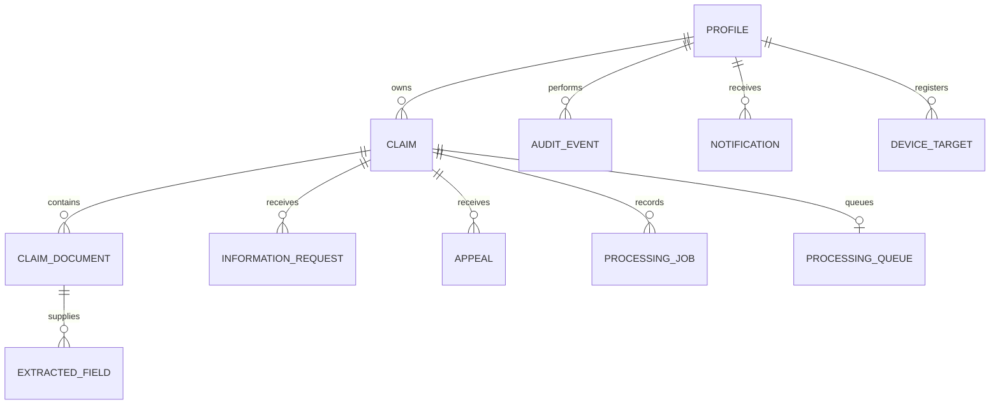

# ClaimLens — Project Portfolio and Technical Handbook

**Project:** ClaimLens  
**Artifact:** Flutter Android application and Python API for medical-insurance claims  
**Documentation date:** 24 November 2026  
**Application version:** 1.1.0+2; API version 1.1.0  
**Author / student ID / programme / supervisor:** complete these academic details yourself.

This handbook describes the implemented project, explains its source-code responsibilities, and provides a structure for a dissertation portfolio. It is not evidence of a completed user study, an insurance accreditation, or a production security certification. Research findings, participant counts, approval letters, usability scores and OCR accuracy must come from work you actually conduct.

Read this file first. The companion **ClaimLens_Source_Reference.md** contains the application and API source with line numbers, a file index and function/class locations. **ClaimLens_API_Schema.json** provides the generated OpenAPI contract. **verification-results.json** distinguishes automated checks from physical-device acceptance and future deployment work. The Word version is generated from this handbook for editing in a dissertation workflow.

## 1. Executive overview

ClaimLens is a mobile application for submitting, extracting information from, reviewing and tracking medical-insurance claims. Clients attach invoices, receipts or supporting evidence. A Python API extracts available text and uses PaddleOCR for images or scanned PDFs. The client checks the proposed values before submitting. Authorized staff can assign work, correct evidence, request additional information, verify a claim, record an approval or rejection, and track settlement.

The project deliberately separates text recognition from decision making. OCR proposes values; it does not prove that a treatment is covered or that a document is genuine. Human reviewers remain responsible for comparing evidence and applying the relevant insurance policy. Payment actions record an administrative status and reference; they do not transfer funds.

The active user interface is Flutter. FastAPI hosts the application rules and document-processing code. Firebase Authentication supplies account identities and tokens. Cloud Firestore stores profiles, claim data, processing records, notifications and audit events. Uploaded documents are kept in private server storage. New uploads are encrypted before being written to that storage. Firebase Cloud Messaging supports generic device notifications without including medical details in the notification text.

The present delivery target is cable debugging on a Samsung Android phone. A debug connection setting also supports a local Wi-Fi/hotspot server or a future HTTPS endpoint. Permanent hosting is deferred at the project owner's request. Neither the current debug APK nor a temporary tunnel should be presented as an independently hosted production service.

## 2. Problem definition and context

A medical claim can contain several different kinds of evidence. Some documents contain payable amounts, others describe treatment, and others repeat the same receipt. A single total copied from every document can therefore overstate a claim. Names, dates, currencies and amounts may also need correction after OCR. Meanwhile, clients need to know whether a claim is waiting for information, being reviewed, approved, rejected or paid.

ClaimLens addresses these coordination and data-entry problems through a structured submission and review process. It centralizes claim evidence, makes extracted proposals visible, records explicit document inclusion decisions, and gives each participant a view appropriate to their role. An audit trail connects consequential changes with an authenticated actor.

The project is a software artifact for exploring this workflow. It does not currently integrate with an insurer's policy-administration system, bank, hospital system or national identity register. Any statement that it reduces turnaround time, improves fraud detection or improves customer satisfaction needs a measured evaluation rather than an assumption.

### 2.1 Stakeholders

| Stakeholder | Need addressed by the application |
| --- | --- |
| Client / claimant | Submit evidence, correct information, see progress, answer questions and request reconsideration |
| Claims officer | Work through accessible claims, inspect source evidence and verify reviewed information |
| Supervisor | Allocate work and record decisions after review |
| Finance user | View settlement-ready claims and record payment method/reference |
| Administrator | Create and manage accounts, roles, permissions and submission requirements |
| Technical operator | Maintain the API, storage keys, backups, queues and deployment configuration |
| Dissertation evaluator | Understand the design, implementation, evidence, limitations and contribution |

## 3. Aim, objectives and possible research questions

**Aim:** develop and evaluate a mobile workflow that combines assisted document extraction with controlled, traceable medical-claim review.

The implemented engineering objectives are:

1. Provide a Flutter interface for clients and staff.
2. Support image, PDF and DOCX evidence with explicit file limits.
3. Extract text through the appropriate document pathway.
4. Present extracted information for human confirmation.
5. Calculate claim totals only from included, nonduplicate payable evidence.
6. Enforce ownership, roles, permissions and state transitions on the API.
7. Support information requests, decisions, appeals and settlement recording.
8. Protect authentication tokens and uploaded evidence.
9. Maintain processing and audit records suitable for troubleshooting and evaluation.
10. Verify important behavior using unit, widget and opt-in integration tests.

Possible dissertation questions, to adapt to the actual study, include:

- How effectively can assisted extraction reduce manual transcription effort while preserving human control?
- Which document characteristics most often require correction?
- Can participants complete the submission and review tasks with acceptable usability?
- Do the implemented authorization and workflow controls prevent the tested misuse scenarios?
- What operational trade-offs arise when combining a mobile interface, cloud identity/database services and Python OCR?

These are proposed research questions, not claims that a formal study has already answered them.

## 4. Development history and design decisions

The conversation and repository history show an evolution from an earlier web/Supabase implementation toward a native Flutter application. Authentication and application records were moved to Firebase. The extraction requirement was clarified as PaddleOCR rather than a dependency on Tesseract. Native staff workflows were then added to restore capabilities that had existed in the web version. Further work added clearer navigation, administrative account controls, claim tools, persistent processing, private storage protection and release checks.

Important decisions are documented below.

| Decision | Reason and consequence |
| --- | --- |
| Flutter for the active interface | One consistent mobile application with native Android integrations |
| FastAPI retained | PaddleOCR and document libraries run in Python; the API centralizes rules and private-file access |
| Firebase Authentication | Managed identities, password sign-in, refresh and recovery mechanisms |
| Firestore profiles as role authority | Account creation and role changes do not depend on a user-supplied email suffix or hidden UI element |
| Server-only Firestore access | The mobile client does not receive Firebase Admin credentials or directly read claim collections |
| Human confirmation after extraction | OCR can be uncertain or incorrect; recognized amounts are proposals |
| Document inclusion controls | Supporting certificates and duplicate receipts should not automatically contribute to the payable total |
| Separate finance rights | Administration and clinical review do not automatically imply payment authority |
| Persistent queue | A processing record survives the request that started it and can be recovered after an expired worker lease |
| Local private storage for the pilot | Avoids enabling paid Firebase Storage while cable development is the immediate target |
| Legacy technical identifiers retained | Preserves existing Firebase users, uploaded files and Android installation compatibility |

**Naming:** the product is **ClaimLens**. The Dart package is `claimlens`. The Firebase project ID `claimelens`, the private runtime directory of that spelling and the existing Android application ID are legacy technical identifiers. They are not the product's display name. Renaming a display label must not silently create a new database or lose access to existing accounts.

## 5. Scope and boundaries

### 5.1 Implemented product scope

- Client signup, sign-in, password recovery and profile settings.
- Public-signup email verification before claim submission.
- Administrator account creation, role/status changes and temporary-password resets.
- Mandatory change of an administrator-set temporary password.
- Client drafts, claim information and evidence upload.
- Camera/gallery input and PDF/DOCX/image file selection.
- Text extraction, PaddleOCR, human corrections and document totals.
- Claim history, search, status filters and assignment filters.
- Source preview, submission receipts and a claim progress timeline.
- Officer assignment, review, verification and information requests.
- Client information responses with additional evidence.
- Supervisor approval/rejection and controlled appeals.
- Finance settlement status, payment method and reference.
- In-app notifications, device registration and generic push delivery code.
- Analytics, audit records and configurable submission requirements.
- Inactivity lock with password or supported device authentication.
- Encrypted new document uploads and operator backup/recovery tools.
- Automated checks and private release-signing configuration.

### 5.2 Explicit boundaries

- No real money is sent by the application.
- No automatic insurance coverage adjudication is claimed.
- Exact document hashes detect tested duplicate evidence; this is not a complete fraud-detection system.
- Biometric/device unlocking protects a local session view. It is **not** server-side multi-factor authentication.
- Provider-backed MFA is not enabled in the current pilot.
- The English recognition model is configured; broad multilingual accuracy has not been established.
- Existing legacy plaintext files remain readable. New uploads are encrypted; an old file does not become encrypted simply because the code was upgraded.
- Permanent internet hosting, production signing and final physical-device acceptance remain distinct release activities.

## 6. Requirements and traceability

| ID | Requirement | Principal implementation area | Evidence approach |
| --- | --- | --- | --- |
| FR-01 | Client registration and login | auth router; signup/login screens; AuthProvider | Auth regression and widget tests |
| FR-02 | Preserve staff identities and roles | FirebaseGateway.ensure_profile; provisioning/accounts routes | Existing-profile role tests |
| FR-03 | Administrator creates and manages users | workspace router; UsersScreen | Authorization and live account tests |
| FR-04 | Admin resets a user's password | users/{uid}/password; temporary-password form | Live reset/change workflow |
| FR-05 | Force replacement of temporary passwords | security dependency; RequiredPasswordScreen | Protected-route and form tests |
| FR-06 | Upload supported evidence | claims router; NewClaimScreen | Signature, file-size and integration tests |
| FR-07 | Save and resume drafts | draft status, information route, history filters | Workflow checks and device acceptance |
| FR-08 | Extract digital and scanned text | processing.py; ocr.py | Digital-PDF, DOCX and real-model tests |
| FR-09 | Confirm/edit extracted values | extracted information and staff review screens | Confirmation and correction integration tests |
| FR-10 | Calculate included-document totals | confirmation transaction; workflow correction | Amount/currency/duplicate validations |
| FR-11 | Search and filter claims | list_claims; HistoryScreen | Scoped API and widget tests |
| FR-12 | Assign/review/verify claims | permissions.py; workflow.py | Role/state boundary tests |
| FR-13 | Request and supply information | information requests/responses | Live privacy and response checks |
| FR-14 | Record approval/rejection | workflow_patch/apply_action | Decision and amount tests |
| FR-15 | Record a payment reference | finance permission and payment action | Settlement sequence tests |
| FR-16 | Provide a receipt and appeal | claim_tools router; claim details | Live PDF/preview/appeal checks |
| FR-17 | Notify users | notifications, push worker, Flutter messaging service | Ownership checks; device delivery acceptance |
| FR-18 | Configure submission requirements | settings routes; HelpScreen | Model validation and administrator checks |
| FR-19 | Report activity and volumes | analytics/audit routes and screens | Scoped reporting checks |
| NFR-01 | Authorize every protected request | get_current_user and gateway/workflow checks | Cross-user and role-denial tests |
| NFR-02 | Protect private evidence | encrypted LocalDocuments and expiring links | Roundtrip, tamper and traversal tests |
| NFR-03 | Recover processing safely | Firestore queue, leases and retries | Lease recovery and real worker tests |
| NFR-04 | Support accessible screen sizes | adaptive cards, wraps, scrollable forms | Small-screen and text-scaling widget tests |
| NFR-05 | Keep secrets out of source | ignored environment/private runtime files | File selection and repository review |
| NFR-06 | Make builds reproducible | package locks, version pins and CI | Analyze/test/build checks |

The source appendix supplies the exact file paths and current line ranges for these implementation areas. It should be regenerated after code changes.

## 7. System architecture



### 7.1 Flutter responsibilities

Screens display the interface and gather input. Model classes translate API JSON into Dart objects. `AuthProvider` holds the signed-in profile, session state and locking behavior. `ClaimsProvider` holds shared claim/dashboard state. `ApiClient` supplies Dio configuration, bearer headers, secure token storage, token refresh and readable errors. Services encapsulate common API operations. Reusable widgets provide the brand mark, claim cards, status indicators, forms and the session guard.

The design separates view code from network/session code, but it is not presented as a perfectly pure architecture: some screens use the shared workspace API helper directly. This is a pragmatic trade-off in the current prototype. Flutter's architecture guidance is useful for explaining service and state boundaries without claiming the repository implements every recommended pattern. [Flutter architecture guide](https://docs.flutter.dev/app-architecture/guide)

### 7.2 API responsibilities

FastAPI defines HTTP routes and validates request bodies. The security dependency verifies Firebase ID tokens, checks revocation and active profiles, and enforces temporary-password restrictions. `FirebaseGateway` provides internal persistence and authorization helpers. Workflow functions calculate available actions and apply guarded changes. Dedicated modules handle documents, OCR, persistent jobs, push delivery, request hardening and backups.

The API is the authority for access and transitions. Hiding a button in Flutter is a usability decision, not the security control. A modified client must still pass the API checks.

### 7.3 Infrastructure responsibilities

Firebase Authentication owns account credentials. Firestore stores application records, but not a copy of each user's plaintext password. Private file storage supplies evidence bytes and encryption keys. The Python host supplies CPU and persistent local storage for the pilot. FCM provides notification transport. A future host must supply a stable HTTPS endpoint and durable storage; installing the Android app alone does not provide those services.

## 8. User roles, permissions and separation of duties

| Role | Default responsibilities | Important restriction |
| --- | --- | --- |
| Client | Own drafts, submissions, responses and appeals | Cannot read another client's claim or grant staff access |
| Claims officer | Accessible review queue, take assignment, review/correct/request information/verify | Cannot decide or record payment by default |
| Supervisor | Review, assign and decide; analytics/audit | Cannot approve a claim verified by the same account |
| Finance | Settlement-ready claim access and payment recording; reporting | Does not receive medical source-document access by default |
| Administrator | User management, assignment and operational reporting | Clinical approval and finance rights are not automatically implied |

Additional review, decision or payment rights can be granted through account administration. Clients do not acquire authority from an additional-permissions list. `users.manage` is not an arbitrary grant that can turn a client into an administrator. The administrator role remains the account-management authority.

The permission names are `claims.review`, `claims.assign`, `claims.decide`, `payments.record`, `users.manage`, `analytics.view` and `audit.view`. Actual execution still depends on ownership, assignment and claim status. A permission is not permission to skip the state machine.

The separation-of-duties check compares authenticated account IDs. It does not prove that two different accounts belong to two different human beings. Organizational account governance is therefore still required.

## 9. Authentication and account lifecycle

### 9.1 Normal sign-in

Flutter submits the email and password to FastAPI. The API calls Firebase's password sign-in endpoint. A successful result is combined with the existing Firestore profile. The app stores access and refresh tokens in Flutter secure storage. Protected requests send the bearer token. The API verifies it and re-reads the current role/status profile.

**Important implementation detail:** Flutter does not currently use the `firebase_auth` package for the application's login flow. Login runs through Dio → FastAPI → Firebase Authentication REST endpoints. Native `firebase_core` and `firebase_messaging` are used for messaging integration. Another AI must not assume that adding a `FirebaseAuth.instance` call will integrate automatically with this session design.

### 9.2 Public registration and verification

Public signup creates a client profile. A client-supplied role does not create staff access. Verification email is requested through Firebase. Public-signup profiles carry a verification requirement; the API checks verified-email status before accepting final claim confirmation. A client can resend the verification message and refresh their session after opening the link.

Existing accounts and administrator-created pilot accounts are preserved rather than silently reclassified or disabled. Real, reachable email addresses are still needed for email recovery and verification.

### 9.3 Administrator-created accounts

An administrator supplies a name, email, role and temporary password. The profile is marked `must_change_password`. The new user can sign in, but protected workspace operations remain unavailable until they choose a personal password. The dedicated screen validates confirmation and prevents retaining the same temporary password.

An administrator can set a replacement temporary password for another account after re-entering their own administrator password. The password itself is not put into audit metadata. Firebase invalidates the previous refresh tokens as part of the password change. A second local-clock revocation was removed after an integration test exposed an immediate-sign-in problem caused by that redundant operation. [Firebase session management](https://firebase.google.com/docs/auth/admin/manage-sessions)

An administrator uses the personal account password-change flow for their own password. An administrator cannot demote, deactivate or delete their own administrator account through the account-management controls, and the last active administrator is protected.

### 9.4 Personal password changes

The user provides the current password and a new password. The backend reauthenticates the current identity before applying the change. Newly chosen passwords use a 12-character minimum and a 128-character maximum in the current build. Existing passwords are not rewritten merely because a new minimum is introduced.

### 9.5 Session protection

The app refreshes short-lived Firebase tokens through the refresh endpoint. Server-side checks reject inactive or revoked identities. Local inactivity locking uses shorter staff timeouts than client timeouts. A supported device can unlock the local view through device authentication, with password unlocking available as a fallback.

Biometric unlocking is not a replacement for Firebase authorization and is not a server second factor. A future provider-backed MFA rollout requires its own enrollment, recovery, enforcement and cost/configuration review. [Local authentication package](https://pub.dev/packages/local_auth)

## 10. Client submission journey

1. The client signs in and sees an overview with key figures and an action-needed list.
2. The client starts a claim and can enter member number, policy number, treatment date and a description.
3. Evidence is selected from camera, gallery or supported files.
4. The app checks the selected file count and size before upload.
5. Upload progress is displayed. A request key allows the server to recognize a repeated upload attempt for the same request.
6. The client can save the upload as a draft or start extraction.
7. For background processing, the app polls claim status rather than holding one long OCR request open.
8. The client compares extracted values with source previews and corrects them.
9. Payable documents are included explicitly, amounts/currencies are confirmed, and duplicates are excluded.
10. A review screen displays the claim total before confirmation.
11. The API validates ownership, state, configured requirements, amounts, currencies and duplicate fingerprints inside the submission workflow.
12. The submitted claim appears in the review queue. A receipt and progress view become available.

Saving a draft means that the uploaded evidence and draft record have reached the backend. Merely selecting files on the phone is not the same thing as a persisted draft. The current app is online-dependent for this server save; it does not claim a fully offline submission queue.

## 11. Document types, validation and extraction

### 11.1 Accepted evidence

The implemented upload paths support PDF, DOCX, JPEG and PNG. The standard limit is ten documents per claim and 10 MB per file. Signatures are checked against the reported MIME type. DOCX ZIP structure and expanded-size limits reduce the risk of an oversized archive. Processing limits also restrict very large images and long/password-protected PDFs.

Camera/gallery images are resized for practical mobile upload. This improves the size/cost trade-off, but the project does not yet contain a validated automatic document-quality classifier or a complete document-scanning/cropping subsystem.

### 11.2 Extraction pathway



The configured OCR engine uses `PP-OCRv5_mobile_det` for detection and `en_PP-OCRv5_mobile_rec` for recognition, with document orientation/unwarping options disabled in the current configuration. Inference is serialized around a cached engine instance. PaddlePaddle 3.2.2 is used because Windows blocked a native library in the previously installed 3.3.1 runtime; real image and scanned-PDF tests were used to verify the compatible runtime.

The PP-OCR research and project documentation explain the OCR family. The application's installed model names and code are the authority for what this prototype actually runs; published paper results are not the application's own evaluation results. [PP-OCR paper](https://arxiv.org/abs/2009.09941), [PaddleOCR project](https://github.com/PaddlePaddle/PaddleOCR)

### 11.3 Fields and confidence

Extraction records retain raw and normalized values, field names, document references, method, confidence and page information. Rules identify candidate patient/provider names, totals, currencies and other supported labels. Results may be missing or ambiguous. Confidence shown in the UI is not a validated probability that an insurance decision is correct.

A proper dissertation evaluation should measure field-level exact match, amount/currency accuracy and human correction effort on a consented, labeled dataset. The current synthetic tests prove selected functional cases, not a general clinical-document accuracy percentage.

## 12. Claim totals and duplicate controls

The payable total is the sum of included document amounts. Included values must be positive and use acceptable currency information. Duplicate copies and nonpayable supporting evidence should not contribute to the total. The current design does not silently combine different currencies or invent an exchange rate.

There are two distinct duplicate controls:

- During extraction, hashes identify repeated bytes within a claim and mark duplicate evidence.
- At confirmation, client-scoped document fingerprints can prevent the same payable bytes from being submitted in another claim by the same client.

This does not detect every re-photographed receipt, edited invoice, shared-family document or semantic duplicate. It should be described as an exact-document safeguard, not as proof of fraud detection. A future semantic detector would require a separate design, evaluation and process for handling false positives.

## 13. Staff review, decisions and settlement

An officer can take an available unassigned review claim or receive an assignment. Reviewers inspect private source previews, correct extracted values and review document inclusion/amounts. Verification requires appropriate identity information and a positive reviewed total. Additional evidence that requires reconfirmation prevents premature verification.

A supervisor or explicitly authorized decision maker can approve or reject a verified claim. Approval requires an approved amount no greater than the claimed total and a decision note. The account that verified the claim cannot approve that same verification. This preserves a meaningful review/decision distinction within the application.

Finance authority is separate. An approved claim can move to payment pending and then paid. Settlement requires a payment method and reference. The application records who acted and when. It does not contact a bank or initiate an electronic payment.

Medical source access is restricted for the default finance role. A finance view can present settlement information without handing out the same evidence access as a clinical reviewer.

## 14. Information requests and appeals

Reviewers can request clarification with a reason, questions, optional required documents, deadline and an internal note. The client sees the public request but not the internal note. Only the owner of the claim can answer. New evidence is associated with the response and can be processed without replacing previously reviewed fields from completed documents.

A rejected claim may be reconsidered through an appeal where the configured limit permits it. The client supplies a reason. The previous decision is preserved in the appeal/audit history, and the claim returns to the review queue with verification/assignment state reset as appropriate. An appeal is not an automatic approval. A reviewer may still request further evidence or reject the reconsidered claim.

## 15. Claim state machine



The diagram is a conceptual summary. Actual API guards also check ownership, assignment, reconfirmation flags, temporary-password restrictions, duplicate evidence, permissions and valid data. A failed information-response processing job must not be treated as a new unsubmitted draft.

## 16. Persistent processing and failure recovery

Background OCR requests create a Firestore queue record. A worker acquires a job transactionally, records a worker identity/lease, and renews the lease while processing. Expired work can be recovered after a restart. Attempts are bounded; a repeatedly interrupted job eventually becomes a visible failure requiring a retry rather than cycling indefinitely.

The worker also checks the claim state before recovering work. A stale processing record must not take an already submitted/reviewed claim back to a draft. This behavior is covered by a dedicated regression test.

Processing records are not a promise of exactly-once execution. The current pilot is designed around a single application instance with controlled worker concurrency. Production horizontal scaling needs a further review of lease fencing, idempotent side effects, retry semantics and notification delivery.

## 17. Data model and Firestore collections

Firestore is a document database, not a SQL database with database-enforced foreign keys. Identifiers such as `claim_id`, `client_id`, `assigned_to` and `actor_id` are logical references. The API enforces the relationships and permissions.

| Collection | Principal information | Ownership / purpose |
| --- | --- | --- |
| profiles | Identity display data, email, role, status, extra permissions, preferences, temporary-password and verification flags | Profile authority for active accounts |
| claims | Reference, client, identity/proposed total, currency, status, assignment, decision, settlement and member/policy information | Central claim record |
| claim_documents | Original name, private storage path, MIME, size, hash, classification, extraction state, amount and inclusion data | Evidence belonging to a claim |
| claim_extracted_fields | Raw/normalized field values, confidence, extraction method, page/document links | Extracted and corrected proposals |
| claim_processing_jobs | Processing attempts, start/finish, completion/failure information | Processing history |
| processing_queue | Durable pending/running work, lease, actor and attempts | Worker coordination |
| document_fingerprints | Client-scoped payable-document fingerprint references | Exact-document resubmission control |
| claim_information_requests | Questions, reason, deadline, internal note, response and state | Reviewer/client clarification |
| claim_appeals | Reconsideration reason, previous decision and actor/date | Appeal history |
| audit_events | Actor, event type, claim/target reference, metadata and time | Traceability |
| notifications | Recipient, generic update information, read state and push state | In-app history and delivery outbox |
| device_tokens | Account/device installation target and update time | Private push registration |
| configuration | Business submission requirements, currencies, appeal limit, support/privacy text | Administrator-controlled settings |

### 17.1 Logical relationships



### 17.2 Important storage distinctions

Firebase Authentication stores the account credentials. Firestore profiles store application roles and preferences. Private server storage holds document bytes. Flutter secure storage holds local session tokens. These are separate responsibilities; a profile role is not a password, and an Android client configuration file is not a Firebase Admin private key.

## 18. Privacy and security controls

| Control | Current implementation and limitation |
| --- | --- |
| Authentication | Firebase ID-token verification and revocation checks |
| Authorization | Server-side ownership, role/permission, assignment and state checks |
| Private evidence | API-authorized previews and short-lived signed source links |
| Encryption at rest | New file uploads encrypted with the cryptography library; legacy compatibility retained |
| Backup protection | Password-derived AES-256-GCM archive encryption with authenticated metadata |
| Secret handling | Admin credentials and runtime keys outside source control |
| Input validation | Typed request bodies, MIME/signature, size and bounded processing checks |
| Password safety | Current-password verification, temporary-password gate, no password audit values |
| Validation privacy | Validation responses omit submitted input values |
| Rate limiting | Persistent local request counters for sensitive endpoints; a multi-instance host needs a distributed design review |
| Session view | Inactivity lock, password/device authentication and safe sign-out behavior |
| Notifications | Generic OS text; medical details require opening the authenticated app |
| Audit | Consequential changes retain actor/date/event metadata |

These controls should be assessed against a mobile-security baseline, but their existence is not an OWASP certification. A penetration test, configuration review and privacy review remain release activities. [OWASP MASVS](https://mas.owasp.org/MASVS/)

Encryption is not end-to-end encryption: the server must decrypt evidence to process it and deliver authorized previews. Operators who control the server/key can access plaintext. Key backup, filesystem permissions, host security, logs, retention and recipient sharing therefore remain important.

No claim of legal compliance should be inferred from this handbook. The organization must determine its obligations, retention rules, hosting/data-processing agreements and approval requirements before using real medical evidence at scale.

## 19. Notifications and messaging

In-app notifications are private records for the recipient. Reading another user's notification is rejected. Workspace unread counts are refreshed periodically. Generic push notifications are processed independently so a messaging problem does not remove the in-app update.

The current Firebase messaging SDK uses Firebase Installation IDs for device registration. The Python SDK supports those targets. Notifications avoid patient names, amounts and medical descriptions in the visible OS text. A reference can be used to navigate to a claim, but that page still goes through API authorization.

The Android Firebase app was registered for the existing package name. Native messaging configuration does not replace the API's login design or permit direct reading of Firestore claim records. OS permission, Google Play services, internet connectivity, backend messaging permission and actual device delivery still need acceptance testing. [Firebase messaging setup](https://firebase.google.com/docs/cloud-messaging/flutter/get-started), [Admin send API](https://firebase.google.com/docs/cloud-messaging/send/admin-sdk)

## 20. Interface inventory and usability rationale

| Screen / area | Main purpose |
| --- | --- |
| Splash | Restore secure session state |
| Login | Shared client/staff sign-in; debug-only connection settings |
| Signup | Public client registration |
| Password recovery | Request a Firebase recovery email |
| Required password change | Replace an administrator-set temporary password |
| Overview | Four focused figures, quick actions, action-needed and recent claims |
| Claim history / queue | Search, status and assignment filtering |
| New claim | Member/policy details, evidence choice, upload progress and draft saving |
| Processing | Progress polling and retry/manual-information routes |
| Extracted information | Confirm proposed identity, fields, inclusion and amounts |
| Review total | Final client confirmation before submission |
| Claim details | Timeline, metadata, documents, decisions, requests, actions and audit history |
| Document preview | In-app image/PDF-page/DOCX-text comparison |
| Staff review | Source-based corrections before verification |
| Information response | Answer questions and supply supporting evidence |
| Notifications | Private update history and read state |
| Analytics | Date-filtered volumes, outcomes and currency-separated amounts |
| Audit trail | Searchable authorized activity |
| User access | Administrator account creation, roles/status and password controls |
| Account/settings | Personal data, appearance, notification preference, password and session lock |
| Help/requirements | Document checklist, privacy text and administrator business settings |

The visual design uses teal, light/dark surfaces, rounded cards, a consistent lens/medical mark and responsive wrapping. Large text is treated as a layout requirement. Automatic tests exposed an overflowing claim-card footer; its layout was changed rather than hiding the failure by reducing test text size. [Flutter accessibility](https://docs.flutter.dev/ui/accessibility)

## 21. Network and execution modes

### 21.1 Cable debugging

Run the API on the computer, enable USB debugging, and use `adb reverse tcp:8000 tcp:8000`. The debug app points to `http://127.0.0.1:8000/api/v1`. The phone accesses the computer's API through the forwarding connection. Firebase services still require the relevant network connectivity.

### 21.2 Wi-Fi or mobile hotspot development

The computer and phone need a network path to each other. Bind the API to an appropriate network interface and select the computer's local address in the debug connection setting. Local IP addresses can change when a network changes. The firewall must permit the intended local connection. This mode is not equivalent to an independently hosted cloud backend.

### 21.3 Future internet hosting

A host must provide a stable HTTPS address, persistent private storage, protected keys, working Firebase credentials, worker supervision and backup/monitoring procedures. The app can be configured for that address. Hosting is intentionally not being activated during the current cable-debug stage, and no billing plan should be enabled without explicit authorization.

## 22. Local setup and reproduction

The repository root contains `mobile/claimlens_mobile`, `services/api`, `firebase`, and `docs`. Do not confuse it with an unrelated Flutter workspace opened elsewhere on the computer.

### 22.1 API

```powershell
Set-Location services/api
py -3.12 -m venv .venv-paddle
.venv-paddle/Scripts/python -m pip install -r requirements-dev.txt
Copy-Item .env.example .env
# Configure the private .env; do not overwrite an existing configured file.
.venv-paddle/Scripts/python -m app.serve
```

Use the exact configured Python environment if it already exists. The example commands show a reproducible setup pattern; they are not a reason to delete an environment or private data directory.

### 22.2 Flutter and phone

```powershell
Set-Location mobile/claimlens_mobile
flutter pub get
adb devices
adb reverse tcp:8000 tcp:8000
flutter run --dart-define=API_BASE_URL=http://127.0.0.1:8000/api/v1
```

If Windows/OneDrive locks generated test/build assets, make a local build copy outside OneDrive while excluding `build`, `.dart_tool` and Gradle caches. Source changes must still be made in the Git repository and synchronized to that build copy.

## 23. Testing strategy and evidence

### 23.1 Automated layers

Python tests cover extraction rules, document privacy, authentication, workflow boundaries, password administration, encrypted backups and queue recovery. Flutter tests cover signup/recovery, role navigation, mandatory password forms, administrator reset UI, dashboards and claim-card layouts. Opt-in tests use Firebase and generated documents to verify important integrated flows.

The current verification report is generated separately so that counts and statuses can be updated without rewriting the engineering discussion. A test count is not an OCR accuracy score and is not a substitute for a real user study.

### 23.2 Representative verified scenarios

- A client cannot access another client's claim or response request.
- Public signup cannot supply an administrator role.
- Existing staff roles/status are not overwritten during profile creation checks.
- An officer must have appropriate assignment/review authority.
- An administrator does not automatically receive decision/payment rights.
- The verifier cannot approve the same verification.
- Settlement cannot skip directly from approved to paid.
- A payment reference/method is required for completed settlement.
- Internal information-request notes are hidden from clients.
- Receipts and previews require an accessible claim.
- Temporary passwords block workspace use until changed.
- Nonadministrators cannot set another user's password.
- A backup rejects wrong-passphrase or tampered content.
- An expired worker lease can be recovered, while a live lease is not stolen.
- A stale queue record does not return a submitted claim to draft.
- Real generated image and scanned-PDF cases exercise PaddleOCR.

### 23.3 Commands

```powershell
# Isolated API checks
python -m pytest -q

# Explicit external-service/model tests, using disposable synthetic accounts
$env:RUN_FIREBASE_LIVE_TESTS='1'
$env:RUN_PADDLE_OCR_TESTS='1'
python -m pytest tests/test_firebase_live.py tests/test_workspace_accounts_live.py tests/test_queue_live.py -q

# Flutter
flutter analyze
flutter test
flutter build apk --debug --dart-define=API_BASE_URL=http://127.0.0.1:8000/api/v1
```

Do not enable external tests casually on an unrelated production project. The supplied live tests clean up their own generated users/records; they must not be rewritten to delete real accounts or send recovery emails to real people.

## 24. Proposed dissertation evaluation

Create a documented, consented dataset or use synthetic/de-identified evidence. Label the ground truth before evaluating extraction. Keep training data, development examples and held-out evaluation cases distinct where relevant.

| Dimension | Possible measure | Evidence to collect |
| --- | --- | --- |
| Text recognition | Character/word error rate | Ground-truth transcriptions and recognized text |
| Critical fields | Exact match and normalized amount/currency accuracy | Labeled patient/provider/amount/currency fields |
| Human correction | Fields edited and time to confirm | Consented task observations or instrumented synthetic sessions |
| Workflow usability | Completion rate, task time, error count, participant feedback | Defined tasks and anonymized study records |
| Authorization | Denied/allowed misuse cases | Repeatable API tests and expected outcomes |
| Reliability | Recovery after interruption, duplicate request handling | Controlled fault scenarios |
| Performance | Upload/extraction/response latency distribution | Device, network, document size and timing methodology |

Report sample size, document variety, camera conditions, language and limitations. Avoid turning confidence values into accuracy percentages. Do not write that participants approved the app unless participants actually evaluated it.

## 25. Backup, recovery and operational responsibility

The `app.backups` command creates an encrypted archive of application records and private document storage. The archive uses a passphrase-derived key and authenticated encryption. A passphrase is entered interactively rather than appearing in a command-line argument. Verify a backup and perform a recovery exercise before relying on it.

```powershell
python -m app.backups create D:\PrivateBackups\claimlens.clb
python -m app.backups verify D:\PrivateBackups\claimlens.clb
python -m app.backups restore D:\PrivateBackups\claimlens.clb --destination D:\ClaimLensRecovery
```

Database creation during recovery requires the explicit `--apply-database` option. The tool does not overwrite conflicting records automatically. Recovery should be performed in a controlled maintenance/recovery environment. A consistent production backup needs an operational snapshot plan rather than assuming that a running multi-step workflow is an atomic database snapshot.

Firebase Authentication accounts/password hashes are not exported by this application backup tool. Store/service credentials and encryption keys supplied only through environment variables need a separate protected recovery plan. Losing an encryption key can make the associated evidence unreadable.

## 26. Release preparation and current limitations

The Android application ID is retained for compatibility. The app's display name and Dart package use the corrected ClaimLens spelling. A production release must use private signing configuration; the build configuration prevents silently using the debug signing key as a production signing arrangement.

Before public release, complete these activities:

- Physical-device checks of every role and major failure path.
- Notification permission, registration, background delivery and account-switch tests.
- Biometric enrollment/fallback and inactivity-lock checks on target devices.
- Approved privacy/support/retention wording and organizational procedures.
- A stable host, durable storage and correctly protected encryption credentials.
- Monitoring, quota/capacity planning and a backup/recovery exercise.
- Formal policy-coverage/approval requirements and insurer integration decisions.
- Provider-backed MFA if required for privileged accounts.
- Release signing, distribution testing and store/privacy declarations.
- Further review before horizontal scaling of workers, limits and push delivery.

These are not reasons to discard the prototype. They define the boundary between a useful tested development artifact and a service ready for real medical-claim operations.

## 27. Dissertation chapter mapping

| Suggested chapter | Material supported by this project |
| --- | --- |
| Introduction | Problem, context, aims, stakeholders and scope |
| Literature / technical background | OCR, human confirmation, mobile architecture, managed identity and mobile security |
| Requirements and methodology | Stakeholders, FR/NFR table, iterative development and actual research/evaluation plan |
| Analysis and design | Architecture, roles, data model, state machine, interfaces and threat boundaries |
| Implementation | Source appendix, API schema, extraction pipeline, permissions and queue/storage design |
| Testing and evaluation | Automated evidence plus your real dataset/user-study results |
| Discussion | Trade-offs, limitations, ethics and implications |
| Conclusion and future work | Contribution actually demonstrated and remaining release/research work |

Keep the student's own account of decisions and evidence. This handbook should support the dissertation, not be submitted unchanged as a claim that unperformed research took place.

## 28. Viva / presentation questions

**Why keep Python when the interface is Flutter?** PaddleOCR and the selected document libraries run on the Python host. Central API rules also avoid placing private administrative credentials in the phone.

**What is the AI component?** OCR detection/recognition assists text extraction. Claim approval is a human-controlled workflow; the app does not currently use an LLM to adjudicate coverage.

**Why confirm extracted values?** Documents differ, OCR can be uncertain, and a technically recognized number is not necessarily the payable total.

**What prevents role spoofing?** The server verifies identity and uses the stored profile/permissions rather than trusting a client-supplied role or a hidden button.

**Why distinguish administration and finance?** Account management does not automatically require authority over clinical decisions or settlement.

**How are duplicates handled?** Byte hashes identify exact repeated evidence, including a client-scoped submission check. Semantic fraud detection is outside the demonstrated scope.

**Can different currencies be summed?** The current workflow requires coherent accepted currency data; it does not silently apply an exchange rate.

**What happens if the API restarts during OCR?** A durable queue and lease/attempt rules support recovery. Stale jobs are checked against the current claim state.

**Are files end-to-end encrypted?** No. New stored files are encrypted at rest, but the authorized server decrypts them for OCR and previews.

**Does a fingerprint replace server authentication?** No. Device authentication unlocks a local session view; API identity and authorization checks remain necessary.

**Does the app work when the development computer is off?** Only after an independent backend and persistent storage are deployed. Cable/local testing currently depends on the running computer.

**What evidence supports quality claims?** Repeatable tests and actual measurements. Synthetic pass cases do not justify an unmeasured accuracy, usability or turnaround-time claim.

## 29. Handover prompt for another AI

> You are helping with ClaimLens, a Flutter Android medical-insurance claim application with a FastAPI/Python backend. Read this portfolio, the current verification report, the OpenAPI schema, and the line-numbered source reference before proposing changes. Product naming is ClaimLens; legacy Firebase/runtime identifiers must not be changed in a way that loses data. Authentication uses the API and Firebase REST/Admin services; native Firebase packages currently support messaging. Treat server checks as authoritative. Preserve client ownership, assignment and permissions, separation of verification/approval, temporary-password restrictions, private document handling and human confirmation of OCR. Hosting is deferred while cable debugging is the immediate target. Never request or expose private service-account keys, passwords, tokens or uploaded medical records. Distinguish implemented/tested behavior from proposed work and do not invent research results. Source line references describe this snapshot and must be regenerated after edits.

## 30. References and further reading

The following primary sources support the technical background. Access date for this portfolio: 24 November 2026. They do not supply the project's own evaluation results.

1. Flutter. *Guide to app architecture.* https://docs.flutter.dev/app-architecture/guide
2. Flutter. *Accessibility.* https://docs.flutter.dev/ui/accessibility
3. Firebase. *Manage user sessions.* https://firebase.google.com/docs/auth/admin/manage-sessions
4. Firebase. *Get started with Firebase Cloud Messaging in Flutter apps.* https://firebase.google.com/docs/cloud-messaging/flutter/get-started
5. Firebase. *Send a message using the Admin SDK.* https://firebase.google.com/docs/cloud-messaging/send/admin-sdk
6. OWASP. *Mobile Application Security Verification Standard.* https://mas.owasp.org/MASVS/
7. Du, Y. et al. (2020). *PP-OCR: A Practical Ultra Lightweight OCR System.* arXiv:2009.09941. https://arxiv.org/abs/2009.09941
8. PaddlePaddle. *PaddleOCR source and documentation.* https://github.com/PaddlePaddle/PaddleOCR
9. Flutter team. *local_auth package documentation.* https://pub.dev/packages/local_auth

## 31. Generated appendices

The portfolio-generation script appends the current endpoint catalogue, request/schema inventory, dependency manifests and file map. The separate source reference contains numbered source lines and symbol locations. Neither generated appendix includes private runtime files, credentials or user-uploaded evidence.

<!-- GENERATED APPENDICES -->

### 31.1 API endpoint catalogue

Generated from the FastAPI OpenAPI schema. Security and role checks must also be read in the routers and dependencies.

| Method | Path | Operation |

|---|---|---|

| POST | `/api/v1/auth/login` | Login |

| POST | `/api/v1/auth/refresh` | Refresh |

| POST | `/api/v1/auth/signup` | Signup |

| POST | `/api/v1/auth/forgot-password` | Forgot Password |

| POST | `/api/v1/auth/logout` | Logout |

| POST | `/api/v1/auth/verification-email` | Send Verification |

| GET | `/api/v1/profile` | Profile |

| PUT | `/api/v1/profile` | Edit Profile |

| POST | `/api/v1/profile/unlock` | Unlock |

| POST | `/api/v1/profile/password` | Change Password |

| GET | `/api/v1/claims` | List Claims |

| POST | `/api/v1/claims` | Create Claim |

| GET | `/api/v1/claims/dashboard` | Dashboard |

| DELETE | `/api/v1/claims/{reference}` | Delete Draft |

| GET | `/api/v1/claims/{reference}` | Get Claim |

| POST | `/api/v1/claims/{reference}/process` | Process |

| POST | `/api/v1/claims/{reference}/confirm` | Confirm Claim |

| GET | `/api/v1/documents/download` | Download Document |

| GET | `/api/v1/workspace/officers` | Officers |

| POST | `/api/v1/claims/{reference}/actions/{action}` | Claim Action |

| POST | `/api/v1/claims/{reference}/information/{request_id}/respond` | Information Response |

| GET | `/api/v1/notifications` | Notifications |

| POST | `/api/v1/notifications/{identifier}/read` | Read Notice |

| GET | `/api/v1/workspace/audit` | Audit |

| GET | `/api/v1/workspace/analytics` | Analytics |

| GET | `/api/v1/users` | Users |

| POST | `/api/v1/users` | Create User |

| PUT | `/api/v1/users/{uid}` | Edit User |

| DELETE | `/api/v1/users/{uid}` | Delete User |

| POST | `/api/v1/users/{uid}/password-reset` | User Reset |

| POST | `/api/v1/users/{uid}/password` | Set User Password |

| GET | `/api/v1/settings` | Settings |

| PUT | `/api/v1/settings` | Edit Settings |

| PUT | `/api/v1/claims/{reference}/information` | Information |

| POST | `/api/v1/claims/{reference}/appeal` | Appeal |

| GET | `/api/v1/claims/{reference}/documents/{identifier}/preview` | Preview |

| GET | `/api/v1/claims/{reference}/receipt` | Receipt |

| GET | `/api/v1/claims/{reference}/receipt/preview` | Receipt Preview |

| POST | `/api/v1/devices` | Register |

| DELETE | `/api/v1/devices` | Unregister |

| GET | `/` | Root |

| GET | `/api/v1/health` | Health Check |

### 31.2 API model inventory

`AdminPassword`, `Appeal`, `AuthSession`, `Body_create_claim_api_v1_claims_post`, `Body_information_response_api_v1_claims__reference__information__request_id__respond_post`, `BusinessSettings`, `ClaimDetails`, `ClaimDocument`, `ClaimInformation`, `ClaimSummary`, `ConfirmClaimRequest`, `DashboardSummary`, `Device`, `DocumentConfirmation`, `EmailRequest`, `ExtractedField`, `FieldCorrection`, `HTTPValidationError`, `LoginRequest`, `PasswordEdit`, `ProcessResult`, `Profile`, `ProfileEdit`, `RefreshRequest`, `SignupRequest`, `UnlockRequest`, `UserCreate`, `UserEdit`, `ValidationError`, `WorkflowInput`

### 31.3 Dependency manifests

#### mobile/claimlens_mobile/pubspec.yaml

```text
name: claimlens
description: ClaimLens mobile client for claim submission and review.
publish_to: none
version: 1.1.0+2

environment:
  sdk: ">=3.4.0 <4.0.0"

dependencies:
  flutter:
    sdk: flutter
  dio: ^5.7.0
  file_picker: ^8.1.4
  flutter_secure_storage: ^9.2.2
  http_parser: ^4.1.2
  image_picker: ^1.1.2
  intl: ^0.20.2
  provider: ^6.1.2
  firebase_core: ^5.2.0
  firebase_messaging: ^17.1.0
  local_auth: ^3.0.2

dev_dependencies:
  flutter_test:
    sdk: flutter
  flutter_lints: ^5.0.0

flutter:
  uses-material-design: true

```

#### services/api/requirements.txt

```text
fastapi==0.141.1
uvicorn==0.52.1
httpx==0.28.1
python-dotenv==1.2.2
python-multipart==0.0.32
PyMuPDF==1.28.2
numpy==1.26.4
opencv-contrib-python==4.10.0.84
paddlepaddle==3.2.2
paddleocr==3.7.0
Pillow==12.1.1
python-docx==1.2.0
firebase-admin==7.8.0

cryptography==50.0.2

```

### 31.4 Source-file map

| File | Lines |

|---|---|

| `firebase/firestore.rules` | 10 |

| `mobile/claimlens_mobile/android/app/build.gradle.kts` | 61 |

| `mobile/claimlens_mobile/android/app/src/main/AndroidManifest.xml` | 50 |

| `mobile/claimlens_mobile/android/app/src/main/kotlin/ai/claimlens/claimlens_mobile/MainActivity.kt` | 5 |

| `mobile/claimlens_mobile/android/app/src/main/res/drawable-v21/launch_background.xml` | 12 |

| `mobile/claimlens_mobile/android/app/src/main/res/drawable/ic_claimlens.xml` | 6 |

| `mobile/claimlens_mobile/android/app/src/main/res/drawable/ic_stat_claimlens.xml` | 4 |

| `mobile/claimlens_mobile/android/app/src/main/res/drawable/launch_background.xml` | 12 |

| `mobile/claimlens_mobile/android/app/src/main/res/values-night/styles.xml` | 18 |

| `mobile/claimlens_mobile/android/app/src/main/res/values/styles.xml` | 18 |

| `mobile/claimlens_mobile/android/settings.gradle.kts` | 27 |

| `mobile/claimlens_mobile/lib/app_theme.dart` | 43 |

| `mobile/claimlens_mobile/lib/config/api_config.dart` | 8 |

| `mobile/claimlens_mobile/lib/main.dart` | 70 |

| `mobile/claimlens_mobile/lib/models/claim.dart` | 253 |

| `mobile/claimlens_mobile/lib/models/selected_document.dart` | 12 |

| `mobile/claimlens_mobile/lib/models/user_profile.dart` | 48 |

| `mobile/claimlens_mobile/lib/providers/auth_provider.dart` | 150 |

| `mobile/claimlens_mobile/lib/providers/claims_provider.dart` | 43 |

| `mobile/claimlens_mobile/lib/screens/app_shell.dart` | 163 |

| `mobile/claimlens_mobile/lib/screens/claim_details_screen.dart` | 749 |

| `mobile/claimlens_mobile/lib/screens/claim_review_screen.dart` | 191 |

| `mobile/claimlens_mobile/lib/screens/dashboard_screen.dart` | 286 |

| `mobile/claimlens_mobile/lib/screens/document_preview_screen.dart` | 118 |

| `mobile/claimlens_mobile/lib/screens/extracted_info_screen.dart` | 462 |

| `mobile/claimlens_mobile/lib/screens/help_screen.dart` | 120 |

| `mobile/claimlens_mobile/lib/screens/history_screen.dart` | 175 |

| `mobile/claimlens_mobile/lib/screens/information_response_screen.dart` | 138 |

| `mobile/claimlens_mobile/lib/screens/login_screen.dart` | 175 |

| `mobile/claimlens_mobile/lib/screens/new_claim_screen.dart` | 315 |

| `mobile/claimlens_mobile/lib/screens/password_recovery_screen.dart` | 118 |

| `mobile/claimlens_mobile/lib/screens/processing_screen.dart` | 133 |

| `mobile/claimlens_mobile/lib/screens/profile_screen.dart` | 195 |

| `mobile/claimlens_mobile/lib/screens/required_password_screen.dart` | 114 |

| `mobile/claimlens_mobile/lib/screens/signup_screen.dart` | 214 |

| `mobile/claimlens_mobile/lib/screens/splash_screen.dart` | 32 |

| `mobile/claimlens_mobile/lib/screens/staff_review_screen.dart` | 210 |

| `mobile/claimlens_mobile/lib/screens/workspace_screens.dart` | 612 |

| `mobile/claimlens_mobile/lib/services/api_client.dart` | 167 |

| `mobile/claimlens_mobile/lib/services/auth_service.dart` | 33 |

| `mobile/claimlens_mobile/lib/services/claim_service.dart` | 87 |

| `mobile/claimlens_mobile/lib/services/push_service.dart` | 61 |

| `mobile/claimlens_mobile/lib/services/workspace_service.dart` | 37 |

| `mobile/claimlens_mobile/lib/widgets/claim_card.dart` | 78 |

| `mobile/claimlens_mobile/lib/widgets/claimlens_logo.dart` | 46 |

| `mobile/claimlens_mobile/lib/widgets/session_guard.dart` | 157 |

| `mobile/claimlens_mobile/lib/widgets/status_chip.dart` | 38 |

| `mobile/claimlens_mobile/lib/widgets/workspace_form.dart` | 158 |

| `mobile/claimlens_mobile/pubspec.yaml` | 29 |

| `services/api/app/__init__.py` | 0 |

| `services/api/app/backups.py` | 157 |

| `services/api/app/config.py` | 41 |

| `services/api/app/documents.py` | 175 |

| `services/api/app/extraction.py` | 331 |

| `services/api/app/firebase.py` | 497 |

| `services/api/app/hardening.py` | 70 |

| `services/api/app/jobs.py` | 128 |

| `services/api/app/main.py` | 97 |

| `services/api/app/ocr.py` | 54 |

| `services/api/app/permissions.py` | 41 |

| `services/api/app/processing.py` | 304 |

| `services/api/app/provision_staff.py` | 82 |

| `services/api/app/push.py` | 117 |

| `services/api/app/routers/__init__.py` | 1 |

| `services/api/app/routers/auth.py` | 159 |

| `services/api/app/routers/claim_tools.py` | 321 |

| `services/api/app/routers/claims.py` | 462 |

| `services/api/app/routers/profile.py` | 113 |

| `services/api/app/routers/workspace.py` | 592 |

| `services/api/app/schemas.py` | 151 |

| `services/api/app/security.py` | 65 |

| `services/api/app/serve.py` | 24 |

| `services/api/app/workflow.py` | 451 |

| `services/api/requirements.txt` | 15 |
